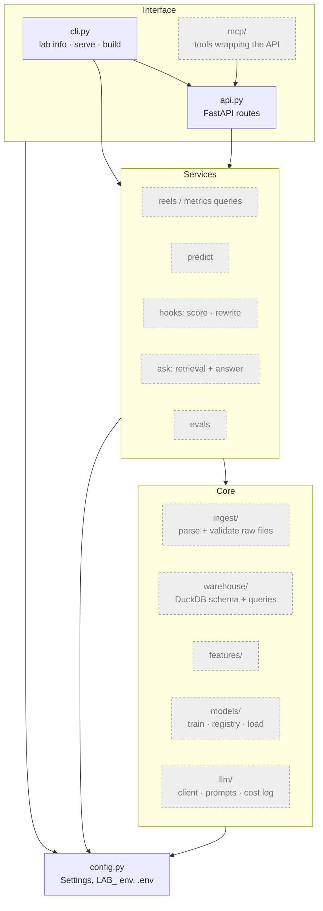
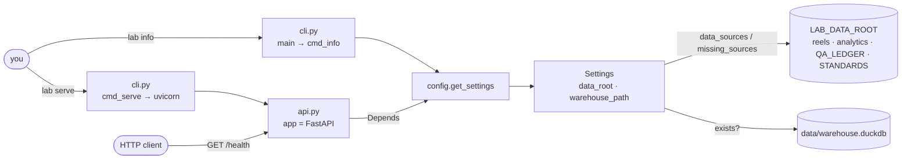
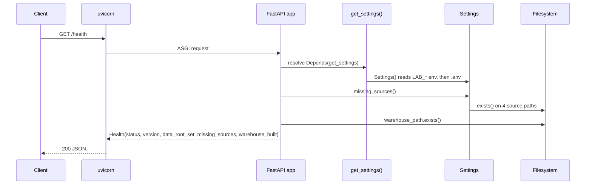

# Architecture

The inside view: packages, how a request moves through them, and what exists today. Updated every phase. For the outside view see [SYSTEM_DESIGN.md](SYSTEM_DESIGN.md).

## 1. Target layers (end of Phase 4)

Each layer may only import from the layers below it. Grey boxes are not built yet.



## 2. What exists now (Phase 0)



| Module | Responsibility | Depends on |
|---|---|---|
| `config.py` | Load settings; list the expected data sources; report missing ones | pydantic-settings |
| `api.py` | HTTP app; `GET /health` returns `ok` or `degraded` with details | config, FastAPI |
| `cli.py` | `lab info` (diagnostics, exit 1 if data is missing) and `lab serve` | config, uvicorn |
| `tests/` | Health states (no data, complete, missing source); CLI exit codes | pytest, TestClient |
| `tools/snapshot.py` | Metrics snapshot after each reviewed change | pytest-cov, radon, ruff, mypy |

## 3. Request flow: `GET /health`



## 4. Repository map

```
pyscroll-lab/
├─ src/pyscroll_lab/     the package (config, api, cli; later ingest, warehouse, features, models, llm, mcp)
├─ tests/                one test file per module
├─ tools/snapshot.py     metrics snapshot → metrics/snapshots/*.json + metrics/HISTORY.md
├─ metrics/              committed snapshot history (engineering metrics now, model metrics later)
├─ docs/                 SYSTEM_DESIGN, ARCHITECTURE, reviews/<date>-<topic>.md
├─ .github/workflows/    CI: ruff, format, mypy (strict), pytest
├─ ROADMAP.md · JOURNAL.md · README.md
└─ data/                 (gitignored) warehouse and derived files
```

## 5. Rules that keep it reviewable

- Interface code (`cli`, `api`, `mcp`) holds no business logic: it parses input, calls a service and formats output.
- All configuration goes through `get_settings()`, so there's one seam for tests.
- Every endpoint has a Pydantic request/response model, and those are the contract.
- Every change ships with tests and a snapshot row; every phase updates this file.
