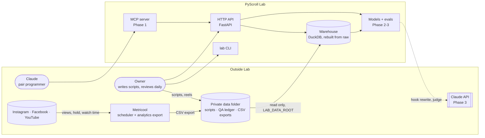
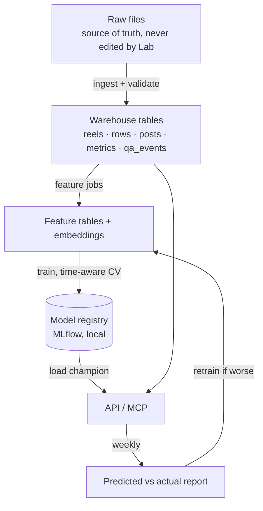

# System design

The outside view: who uses Lab, what goes in and out, what it promises, and the big decisions. For the inside (modules and code) see [ARCHITECTURE.md](ARCHITECTURE.md).

## 1. Context

## 2. What the system must do

| Capability | Endpoint or command | Phase |
|---|---|---|
| Show whether it can work (config, data present, warehouse built) | `lab info`, `GET /health` | 0 ✅ |
| Rebuild a queryable warehouse from the raw files | `lab build` | 1 |
| Read reels, posts and metrics; summaries by format, hook rule or week | `GET /reels`, `/metrics/summary` | 1 |
| Load a new analytics export safely | `POST /ingest/metrics` | 1 |
| Predict 3-second hold for a draft hook, with an interval | `POST /predict/hold` | 2 |
| Score and rewrite hooks; answer questions with citations | `/hooks/score`, `/hooks/rewrite`, `/ask` | 3 |
| Run evals; report predicted vs actual each week | `/evals/run`, `/monitor/weekly` | 3-4 |
| Give Claude the same powers as tools | MCP server | 1+ |

## 3. Qualities it has to keep (non-functional)

| Quality | Target | How we check it |
|---|---|---|
| **Privacy** | Channel data never enters the public repo | `.gitignore` covers `data/`, `*.duckdb` and `.env`; review checklist item |
| **Reproducible** | Delete the warehouse, run `lab build`, get the same tables | Idempotency test in Phase 1 |
| **Runs on the laptop** | No CUDA. Training under ~5 min on CPU, API answer under ~200 ms (non-LLM) | Timings in the metrics snapshot |
| **Honest numbers** | Every model metric is time-aware cross-validated and compared to a baseline | Eval report in each snapshot from Phase 2 |
| **Works without data** | CI and fresh clones run with no private data (`degraded`, not crash) | `test_health_*` |
| **Cost bounded** | Claude API spend under a monthly cap | Cost per eval run logged (Phase 3) |
| **Reviewable** | One small change per day, every metric tracked | `tools/snapshot.py`, `metrics/HISTORY.md`, `docs/reviews/` |

## 4. Data flow and boundaries

**Trust boundary:** everything left of the warehouse is private and read-only. Everything Lab writes (warehouse, features, models, reports) is derived and can be rebuilt, so it's never committed.

## 5. Key decisions

| Decision | Chosen | Why | Revisit when |
|---|---|---|---|
| Storage | DuckDB file | SQL, fast analytics, no server, laptop-friendly | Multiple writers or a hosted API |
| API | FastAPI + Pydantic | Typed contracts, auto OpenAPI docs, the industry default | — |
| AI access | MCP server wrapping the API | One contract for people and Claude | — |
| ML stack | scikit-learn / gradient boosting / small CPU embeddings | No GPU, ~60 labelled rows to start | Data grows past a few thousand rows |
| Tracking | MLflow, local file store | Runs, artifacts and registry without a server | — |
| Repo | Public; data external via `LAB_DATA_ROOT` | Shows the work, protects the data | — |
